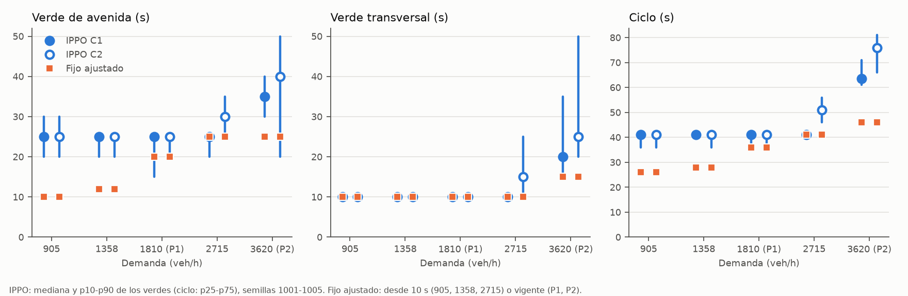
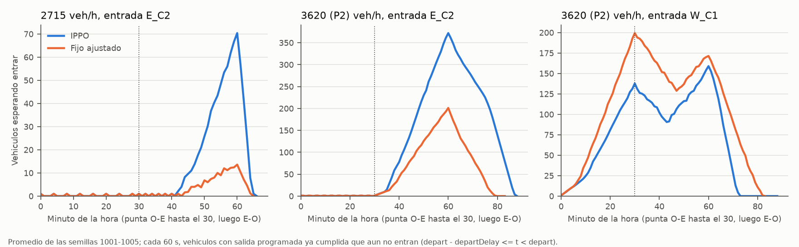

# Qué hace cada control en el corredor (diagnóstico de comportamiento, 25.10.2026)

Análisis posterior al veredicto (PRERREGISTRO.md). No cambia ningún veredicto ni corrige nada: describe lo que
hacen los semáforos en los cinco niveles. Las causas que no están medidas aquí quedan como hipótesis del prerregistro.

## Datos y método

- **Corridas.** 23 combinaciones de nivel y control × semillas 1001-1005 = 115 corridas nuevas, con el código del
  commit 5196edb (copia de solo lectura) y las funciones de `evaluar.py`. Se usaron la misma política congelada y el
  mismo programa que en la evaluación del plan. En cada corrida quedan el tripinfo completo (con `departDelay`), las
  estadísticas de SUMO, la fase de cada semáforo por segundo y los detenidos por acceso **cada segundo**. La serie del
  plan es cada 60 s: con ciclos fijos de 26-46 s, eso muestrea siempre los mismos puntos del ciclo, así que no se usó.
- **Controles.** IPPO con mensajes es la versión evaluada de cada nivel: 905 s4042, 1358 s42, P1 s4042, 2715 s2042 y
  P2 s2042. El fijo ajustado desde 10 s es corredor_f050, f075 y f150 en 905, 1358 y 2715; en P1 y P2 es el fijo
  vigente, que es el mismo programa que el del 25.09. También se corrieron el fijo del 25.09, el ciclo mínimo
  (trivial, 10/10 s) y el actuado.
- **Comprobaciones.** Las 115 corridas dan exactamente el retraso total, el timeLoss, la espera para entrar y los
  cambios de fase de la evaluación del plan con la misma semilla. Los 23 archivos de fases de la semilla 1001 son
  idénticos a los `plan2/fases_*_s1001.csv` existentes (`comp_control.csv`). Hay 0 teletransportes, pero porque la
  configuración los desactiva (`time-to-teleport -1`): es un dato de la configuración, no prueba que no haya atascos.
  Solo el ciclo mínimo en P2 deja vehículos sin insertar (218-247 por semilla).
- **Definiciones.** La fase 0 es la transversal (N-S) y la 2 la avenida (E-O); las fases 1 y 3 son ámbares de 3 s.
  La punta va de oeste a este en 0-1800 s (periodo 1) y de este a oeste en 1800-3600 s (periodo 2). La banda verde es
  la fracción de los segundos de verde de avenida aguas arriba en que un vehículo libre, 22 s después (300 m a
  13.89 m/s), encuentra verde de avenida en el cruce siguiente. Todas las calles tienen un carril.
- **Reproducir** (desde plan2/): `python diag_corredor/comportamiento.py correr --datos <carpeta>`, luego `analizar` y
  `figuras` con la misma `--datos`. Las corridas tardan unos 3 min con 6 procesos.

## Resumen por nivel (semillas 1001-1005)

| Nivel | Control | Verde avenida C1/C2, mediana (s) | Verde transversal C1/C2 (s) | Ciclo C1/C2 (s) | Cambios/h por semáforo | Desfase O→E / E→O (s) | Banda O→E / E→O |
|---|---|---|---|---|---|---|---|
| 905 | IPPO | 25 / 25 (p10-p90 20-30) | 10 / 10 | 41 / 41 | 185 | 30 / 8 | 0.49 / 0.43 |
| 905 | fijo desde 10 s = ciclo mínimo | 10 / 10 | 10 / 10 | 26 | 276 | 0 / 0 | 0.60 / 0.60 |
| 1358 | IPPO | 25 / 25 (20-25) | 10 / 10 | 41 / 41 | 179 / 184 | 21 / 20 | 0.88 / 0.91 |
| 1358 | fijo desde 10 s (12/10) | 12 / 12 | 10 / 10 | 28 | 257 | 0 / 0 | 0.50 / 0.50 |
| 1358 | ciclo mínimo | 10 / 10 | 10 / 10 | 26 | 276 | 0 / 0 | 0.60 / 0.60 |
| 1810 P1 | IPPO | 25 / 25 (15-25) | 10 / 10 | 41 / 41 | 189 / 185 | 18 / 21 | 0.76 / 0.87 |
| 1810 P1 | fijo (20/10, desfase 15) | 20 / 20 | 10 / 10 | 36 | 200 | 15 / 21 | 0.65 / 0.95 |
| 2715 | IPPO | 25 / 30 | 10 / 15 | 41 / 51 | 179 / 140 | 30 / 14 | 0.54 / 0.56 |
| 2715 | fijo desde 10 s (25/10) | 25 / 25 | 10 / 10 | 41 | 175 | 0 / 0 | 0.36 / 0.36 |
| 3620 P2 | IPPO | 35 / 40 | 20 / 25 | 64 / 76 | 111 / 96 | 22 / 42 | 0.61 / 0.43 |
| 3620 P2 | fijo (25/15, desfase 25) | 25 / 25 | 15 / 15 | 46 | 156 | 25 / 21 | 0.88 / 0.96 |

Fuentes: `comp_verdes.csv`, `comp_ciclo.csv` y `comp_sincronia.csv`; la banda es el promedio de los dos periodos.
Figura: `comp_verdes.png`.

**Lo que se ve en todos los niveles.** En 905, 1358 y 1810, IPPO aplica casi el mismo plan, aunque cada nivel tiene su
propio entrenamiento:

- La transversal recibe siempre el mínimo de 10 s: el 100 % de los verdes transversales cambia en la primera decisión
  posible (`comp_decisiones.csv`).
- La avenida recibe 20-25 s: el 78 %, 95 % y 86 % de sus verdes duran 20 o 25 s.
- El ciclo es de 41 s.

El fijo ajustado, en cambio, pasa de un ciclo de 26 s (905) a 28 s (1358) y a 36 s (1810). El reloj de decisión de
IPPO (verde mínimo de 10 s y una decisión cada 5 s) solo permite verdes de 10, 15, 20... s: el 12/10 del fijo de 1358
no está a su alcance, aunque el 10/10 del ciclo mínimo sí lo está.

## Respuestas

### (a) 1358: ¿IPPO alarga los verdes?

Sí, y lo hace **en la avenida, en los dos semáforos**. Su verde de avenida tiene mediana de 25 s en C1 y C2 (el
73 % de los verdes dura 25 s y el 22 % dura 20 s). El fijo da 12 s y el ciclo mínimo, 10 s. El verde transversal
queda en 10 s, igual que en las dos referencias. Por eso el ciclo pasa de 28 s (fijo) o 26 s (ciclo mínimo) a 41 s,
y los cambios de fase bajan de 257 a 179-184 por hora y semáforo.

Con el verde de avenida en curso, IPPO cambia de fase en el 15 % (C1) de las decisiones con 1 detenido en la
transversal y en el 21 % (C1) y el 35 % (C2) con 2 detenidos. En 905, con los mismos detenidos, cambia en el 75 % y
el 96 % (C1).

Efecto por movimiento frente al fijo desde 10 s (`comp_aporte.csv`, `comp_movimientos.csv`):

- **Avenida:** 16.9 frente a 20.8 s de retraso por vehículo. IPPO consigue desfases de 20-21 s y una banda de 0.9
  en los dos sentidos; el fijo tiene desfase 0 y banda de 0.5.
- **Transversal:** 22.2 frente a 14.5 s por vehículo.
- **Giros:** 22.5 frente a 24.3 s por vehículo.
- **Neto:** +1.05 s por vehículo (19.78 frente a 18.73 s; +5.6 %, en línea con el +5.4 % de 30 semillas). La pérdida
  en la transversal (+4221 s·veh por semilla) es mayor que la ganancia en la avenida (−2469 s·veh).

### (b) 2715 y P2: ¿dónde crece la espera para entrar y qué deja de atender IPPO?

En los dos niveles crece en la **entrada E_C2**, la de la avenida por el este, y solo en el **periodo 2**, cuando la
punta va de este a oeste (`comp_entrada.csv`, figura `comp_espera_entrar.png`). Las demás entradas de IPPO no esperan
más que el fijo.

- **2715.** La espera media en E_C2 en el periodo 2 es de 89.7 s con IPPO frente a 17.8 s con el fijo. En las 5
  semillas IPPO queda entre 58 y 119 s. El fijo tiene 0.5 s en 4 semillas y 87 s en una (`comp_entrada_semilla.csv`).
  En las 30 semillas del plan, la espera para entrar media de todos los vehículos va de 7.5 a 32 s con IPPO; con el
  fijo queda bajo 1 s en 18 de 30 semillas (`demanda2/eval_dem_corredor_t2715_*.csv`).
  - En C1, IPPO hace lo mismo que el fijo: 25/10, ciclo 41.
  - La diferencia está en **C2 durante el periodo 2**: el verde transversal sube a una mediana de 20 s (fijo: 10) y la
    fracción del verde para la avenida baja a 0.58 (fijo: 0.714).
  - En ese periodo, con el verde transversal de C2 en curso y 5 o más detenidos en la avenida, IPPO extiende la
    transversal en el 67 % de las decisiones (cambia en el 33 %).
  - En el acceso E_C2 hay en promedio 11.4 detenidos (fijo: 2.3) y la punta E→O pierde 166.5 s por vehículo (fijo: 90.4).
  - En el periodo 1, IPPO es mejor que el fijo: 29.3 frente a 38.4 s de retraso total.
  - En la hora, el cambio es de +19.7 s por vehículo. La avenida en el periodo 2 aporta +23.4 s por vehículo, la mitad
    como espera para entrar.
- **3620 (P2).** La espera media en E_C2 en el periodo 2 es de 964 s con IPPO frente a 395 s con el fijo; las 5
  semillas quedan entre 904 y 1036 s, y el fijo entre 367 y 446 s.
  - En el periodo 2, IPPO alarga la transversal en los dos cruces, con mediana de 30 s (C1) y 35 s (C2) frente a 15 s
    del fijo. La fracción de verde para la avenida baja a 0.50 en C1 y 0.46 en C2 (fijo: 0.62-0.63).
  - El acceso E_C2 tiene 23.9 detenidos de media (fijo: 8.9), y la banda E→O en el periodo 2 es de 0.26 (fijo: 0.96).
  - A cambio, IPPO reduce la espera en W_C1 (periodo 1: 216 frente a 352 s; periodo 2: 759 frente a 1010 s).
  - También elimina la espera en las entradas transversales N1_C1 y S2_C2, que con el fijo es de 107 y 132 s en el
    periodo 2 (con IPPO, 0.7 s).
  - Balance por vehículo del nivel: transversal −35.6 s, giros −9.3 s, avenida en el periodo 1 −28.5 s y avenida en
    el periodo 2 +79.9 s. Neto: +6.4 s (398.9 frente a 392.5 s; en timeLoss, IPPO 118 frente a 154 s).

### (c) P1: ¿qué hace IPPO distinto del fijo?

- **Verdes.** Verde de avenida más largo (mediana de 25 s frente a 20 s) y transversal igual (10 s). El ciclo es de
  41 s (media de 38) frente a 36 s.
- **Sincronía.** Los desfases de IPPO son de 18 s O→E y 21 s E→O, los dos cerca de los 22 s de viaje libre. El fijo
  tiene 15 s y 21 s: con un ciclo de 36 s, favorece la dirección E→O (banda de 0.95) a costa de la O→E (0.65). IPPO
  tiene bandas de 0.87 (O→E, periodo 1) y 0.85 (E→O, periodo 2), las dos en la punta.
- **Dónde gana.** La mejora está en la punta O→E del periodo 1:
  - Paradas: 0.58 frente a 0.86.
  - Vehículos sin parar: 43 % frente a 19 %.
  - timeLoss: 20.4 frente a 24.3 s.
  - Por movimiento, la avenida aporta −1.04 s de los −1.31 s por vehículo del total (80 %), los giros −0.20 s y la
    transversal −0.06 s.
  - La espera para entrar es igual (0.37 s).
- **Extensiones.** Con verde de avenida, IPPO cambia en el 2-7 % de las decisiones con 0-1 detenidos en la
  transversal y en el 40-53 % con 2 o más. La transversal la corta en el mínimo: el 99.8 % de sus verdes dura 10 s.

### (d) 905: ¿IPPO se parece al ciclo mínimo?

**No.** El ciclo mínimo es 10/10 s con ciclo de 26 s. IPPO da a la avenida 20-30 s (mediana de 25 s, solo un 3 % de
verdes de 10 s) y a la transversal 10 s, con ciclo de 41 s, 185 cambios por hora (ciclo mínimo: 276) y desfases
variables (O→E: 30 s de mediana, rango intercuartil 9-35).

El retraso total es casi igual (15.93 frente a 15.90 s), pero el reparto es otro. Frente al ciclo mínimo, IPPO:

- empeora la avenida: 18.7 frente a 16.6 s;
- mejora la transversal: 10.9 frente a 11.8 s;
- mejora los giros: 21.3 frente a 25.7 s.

En este nivel IPPO sí responde a la transversal: con la avenida en verde, cambia en el 75 % (C1) y el 58 % (C2) de las
decisiones con 1 detenido en la transversal, y en el 96 % y el 89 % con 2.

## Lo que muestran los datos, en conjunto

1. **Hasta 1810, IPPO aplica un plan casi constante** (25/10, ciclo 41, desfases cercanos a los 22 s de viaje en 1358
   y 1810). El fijo ajustado, en cambio, cambia con la demanda. Frente a un fijo de ciclo largo (P1, 20/10 con desfase
   15) IPPO gana por sincronía en la avenida. Frente a un fijo de ciclo corto, gana en la avenida pero pierde en la
   transversal, que espera un rojo más largo (en 1358, 25 + 3 + 3 = 31 s en vez de 12 + 3 + 3 = 18 s). En 905 el
   balance es nulo (+0.1 %) y en 1358 es negativo (+5.6 %).
2. **Cerca de la saturación (2715, P2)**, IPPO alarga el verde transversal de C2 (y en P2 también el de C1) en el
   periodo 2. La avenida E→O recibe menos verde, el acceso E_C2 se llena y la espera para entrar por E_C2 crece. Esa
   espera no entra en el timeLoss: en P2, IPPO mejora el timeLoss un 23 % y empata en retraso total. Que esto venga de
   que la recompensa no ve la espera para entrar es la hipótesis H2 del prerregistro; esta medición es compatible con
   ella, pero no la prueba.
3. **SUMO se comporta de forma determinista** y reproduce la evaluación del plan con exactitud. El fijo de 2715 está
   en un borde: en 12 de 30 semillas del plan también tiene espera para entrar (más de 1 s de media). En las 5
   semillas de aquí, cuando la tiene (1002), es por E_C2 en el periodo 2.

## Archivos

- `comportamiento.py`: script con las acciones `correr`, `analizar` y `figuras`.
- Tablas:
  - `comp_verdes.csv`: duración de los verdes por fase y semáforo, total y por periodo.
  - `comp_ciclo.csv`: ciclo, cambios por hora y fracción de verde para la avenida.
  - `comp_sincronia.csv`: desfases, bandas, verde simultáneo y paradas de la punta.
  - `comp_colas.csv`: detenidos por acceso y periodo.
  - `comp_entrada.csv` y `comp_entrada_semilla.csv`: espera para entrar por arista de entrada.
  - `comp_espera_serie.csv`: vehículos esperando entrar cada 60 s.
  - `comp_movimientos.csv`: retraso por movimiento.
  - `comp_aporte.csv`: reparto del cambio de IPPO frente al fijo ajustado.
  - `comp_decisiones.csv`: huella de decisión de IPPO.
  - `comp_control.csv`: comprobaciones de determinismo, teletransportes y no insertados.
- Figuras: `comp_verdes.png` y `comp_espera_entrar.png`.
- La huella de decisión usa los detenidos (velocidad < 0.1 m/s) un segundo antes de cada instante de decisión. La
  política observa más cosas que eso, así que es una descripción de lo que hace, no la regla que sigue.
